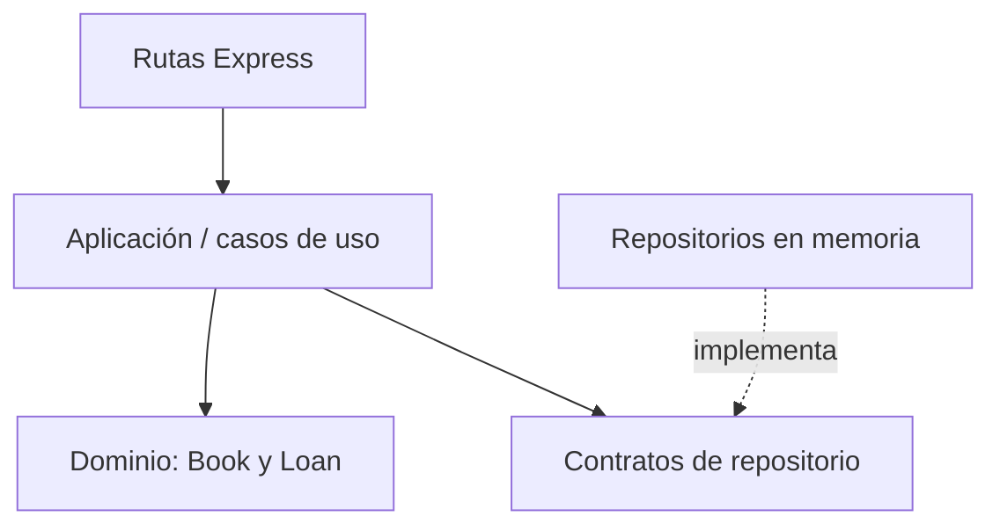

# BookFlow — API REST con Node.js y TypeScript

API de demostración para administrar libros, inventario, préstamos y devoluciones de una biblioteca. Implementa las mismas reglas de negocio que las versiones de BookFlow en .NET y PHP, para comparar cómo se organiza una solución por capas en distintos lenguajes.

> **Alcance:** proyecto personal de portafolio con datos ficticios. Utiliza repositorios en memoria; los registros se pierden al detener el servidor.

## Funcionalidades

- Consultar y registrar libros.
- Consultar y registrar préstamos.
- Devolver un préstamo una sola vez.
- Validar ISBN duplicado y cantidades no válidas.
- Rechazar préstamos cuando no hay ejemplares disponibles.
- Exponer un endpoint de salud.
- Validar solicitudes con Zod y ejecutar pruebas con Vitest.

## Tecnologías

- Node.js y TypeScript.
- Express para exponer la API REST.
- Zod para validar solicitudes.
- Vitest para pruebas.

## Arquitectura



- `src/domain`: entidades y reglas de negocio.
- `src/application`: casos de uso y contratos (puertos) para persistencia.
- `src/infrastructure`: adaptadores de repositorio en memoria y datos iniciales.
- `src/api`: rutas HTTP, validación de entradas y manejo de errores.
- `src/server.ts`: composición de dependencias e inicio del servidor.

## Requisitos

- Node.js 22 LTS recomendado para este proyecto.
- npm.

Si PowerShell devuelve Node `v13.14.0`, actualiza Node antes de continuar: esa versión es demasiado antigua para las herramientas actuales de Angular y puede ser incompatible con dependencias del proyecto. Descarga una versión LTS desde https://nodejs.org/en/download.

## Instalación y ejecución

En PowerShell, desde la raíz del repositorio:

```powershell
node --version
npm install
npm run dev
```

La API estará disponible en `http://localhost:3000`.

## Ejecutar pruebas y compilación

```powershell
npm test
npm run build
```

Ejecuta estos comandos localmente y comprueba los resultados antes de indicar que la compilación y las pruebas pasaron en tu entorno.

## Endpoints

| Método | Ruta | Función |
|---|---|---|
| `GET` | `/api/health` | Comprobar disponibilidad |
| `GET` | `/api/books` | Listar libros |
| `POST` | `/api/books` | Registrar libro |
| `GET` | `/api/loans` | Listar préstamos |
| `POST` | `/api/loans` | Crear préstamo |
| `PATCH` | `/api/loans/:id/return` | Devolver préstamo |

Ejemplo para crear un libro:

```json
{
  "title": "Clean Code",
  "author": "Robert C. Martin",
  "isbn": "9780132350884",
  "totalCopies": 2
}
```

Para crear un préstamo, primero consulta `GET /api/books` y utiliza un identificador válido:

```json
{
  "bookId": "ID_DEL_LIBRO",
  "borrowerName": "Alex Rivera",
  "dueDate": "2026-11-01T12:00:00.000Z"
}
```

Para devolverlo, envía `PATCH /api/loans/ID_DEL_PRESTAMO/return`.

## Principios SOLID y código limpio

- **Responsabilidad única:** las rutas gestionan HTTP, el servicio coordina los casos de uso y las entidades mantienen las reglas.
- **Inversión de dependencias:** los casos de uso dependen de contratos de repositorio y no de un motor de base de datos concreto.
- La validación HTTP con Zod se mantiene en el límite de entrada.
- Los cambios de inventario se realizan a través del dominio, evitando dispersar reglas en los controladores.

## Limitaciones

La persistencia en memoria se reinicia al detener el servidor. La demostración no incluye autenticación, autorización, base de datos, rate limiting, bloqueo distribuido, observabilidad ni despliegue productivo. Usa exclusivamente datos ficticios.

## Próximas mejoras

- Sustituir repositorios en memoria por PostgreSQL y migraciones.
- Añadir autenticación y autorización.
- Agregar pruebas de integración de HTTP.
- Implementar logs estructurados e identificador de correlación.
- Configurar CI con GitHub Actions.

## Contexto del proyecto

Proyecto personal de portafolio para explorar reglas de negocio, contratos, casos de uso, validación y separación por capas con Node.js y TypeScript.
