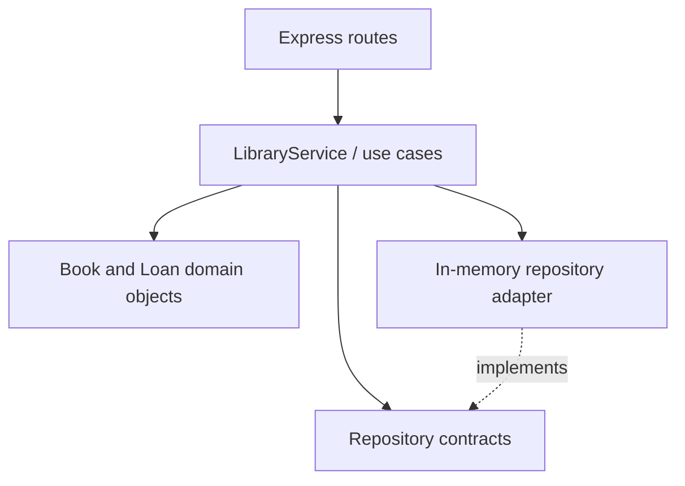

# BookFlow — Node.js + TypeScript API

A REST API implementing the same library inventory and lending rules as the .NET and PHP versions. It uses Express, TypeScript, domain entities, application use cases, repository contracts, and an in-memory adapter.

## Features

- `GET /api/books` and `POST /api/books`
- `GET /api/loans` and `POST /api/loans`
- `PATCH /api/loans/:id/return`
- Duplicate ISBN and invalid quantity checks
- No checkout when available copies are zero
- No duplicate returns
- Health endpoint at `/api/health`
- Zod request validation and tests with Vitest

## Architecture



- `src/domain`: business entities and invariants.
- `src/application`: use cases and repository ports.
- `src/infrastructure`: in-memory repositories and seed data.
- `src/api`: HTTP routes, input validation, and error mapping.
- `src/server.ts`: composition root and process startup.

## Requirements

- Node.js 22 LTS (or another supported version compatible with the package dependencies)
- npm

If your Windows terminal still reports Node `v13.14.0`, upgrade Node before running this project or Angular 20. Node 13 is end-of-life and too old for modern Angular tooling. Download a supported LTS from https://nodejs.org/en/download.

## Install and run

```powershell
npm install
npm run dev
```

API listens on `http://localhost:3000`.

```powershell
npm test
npm run build
```

## Example requests

Create a book:

```http
POST /api/books
Content-Type: application/json
```

```json
{ "title": "Clean Code", "author": "Robert C. Martin", "isbn": "9780132350884", "totalCopies": 2 }
```

Create a loan (replace the ID with one returned by `GET /api/books`):

```json
{ "bookId": "BOOK_ID", "borrowerName": "Alex Rivera", "dueDate": "2026-11-01T12:00:00.000Z" }
```

Return a loan:

```http
PATCH /api/loans/LOAN_ID/return
```

## SOLID / Clean Code notes

- **SRP:** route handlers handle HTTP; `LibraryService` orchestrates use cases; domain objects enforce stock and return rules.
- **OCP/DIP:** the use case depends on repository contracts; the storage adapter can be replaced with PostgreSQL/Prisma without rewriting domain rules.
- Request schemas are validated at the HTTP boundary with Zod.
- Domain entities own state transitions instead of scattering stock changes across routes.

## Important limitations

This starter uses in-memory repositories: records reset when the process stops. It has no authentication, authorization, database persistence, rate limiting, distributed locking, or production deployment. All people and loans are fictional. Do not claim that this is production-ready; verify the endpoints and tests locally before sharing it with a recruiter.

## Next improvements

- Replace the in-memory adapter with PostgreSQL and migrations.
- Add authentication and authorization.
- Add integration tests against a test database.
- Add structured logs and a request correlation ID.
- Add CI via GitHub Actions.
